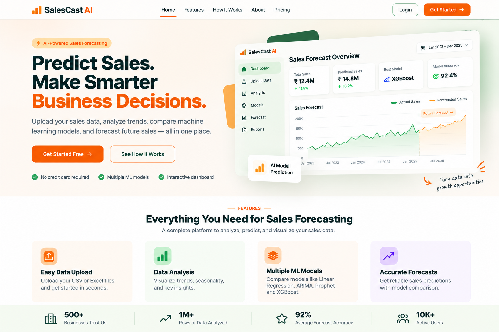
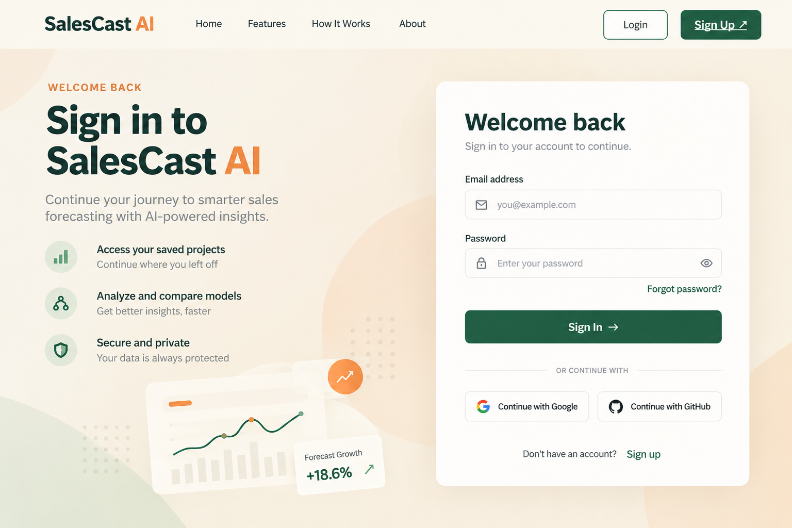
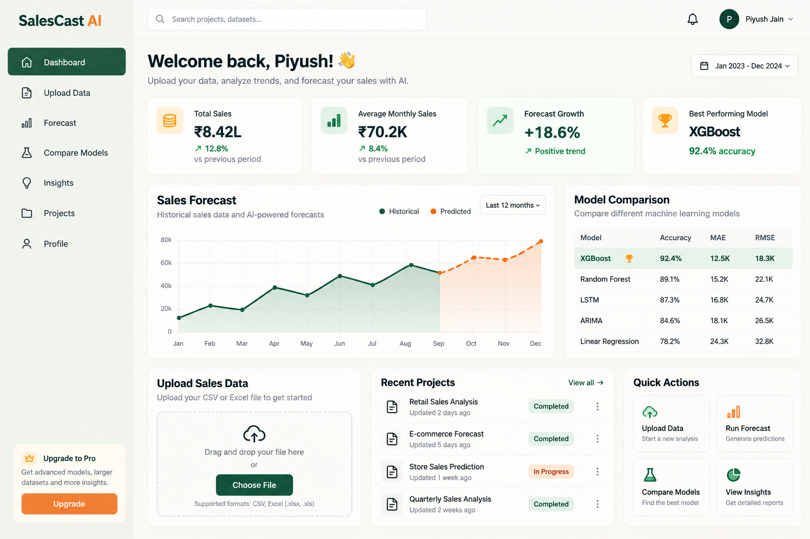

# 📊 SalesCast AI — Project Plan

## 1. Overview
SalesCast AI is an AI-powered platform that analyzes historical sales data, compares machine learning models, and forecasts future sales.

## 2. Key Features
- 📁 CSV/Excel dataset upload
- 🧹 Data cleaning and preprocessing
- 📈 Sales trend and seasonality analysis
- 🤖 Multiple forecasting models
- 📊 Model comparison using MAE and RMSE
- 🎯 Best-performing model recommendation
- 📉 Interactive forecast visualizations
- 📄 Downloadable reports
- 🔐 User authentication and forecast history

## 3. Website Pages

### 🏠 Home Page

### 📝 Sign Up Page
<!-- Add screenshot:  -->

### 🔐 Login Page
<!-- Add screenshot:  -->

### 📊 Dashboard
<!-- Add screenshot:  -->

### 📄 Reports & History
<!-- Add screenshot:  -->

### ⚙️ Profile & Settings
<!-- Add screenshot:  -->

## 4. Machine Learning Models
- **Linear Regression:** Baseline model
- **ARIMA/Prophet:** Time-series forecasting
- **XGBoost:** Machine learning comparison model

**Evaluation:** MAE and RMSE using chronological test data.

## 5. Technology Stack
- **Frontend:** React, Tailwind CSS
- **Backend:** Python, FastAPI
- **Data Processing:** Pandas, NumPy
- **Machine Learning:** Scikit-learn, Statsmodels, XGBoost
- **Database:** PostgreSQL
- **Visualization:** Recharts

## 6. Project Workflow
**Upload Dataset → Analyze Data → Train Models → Compare Performance → Forecast Sales → Download Report**

## 7. Expected Outcome
A user-friendly platform that helps businesses analyze sales trends, compare predictive models, and make data-driven decisions.